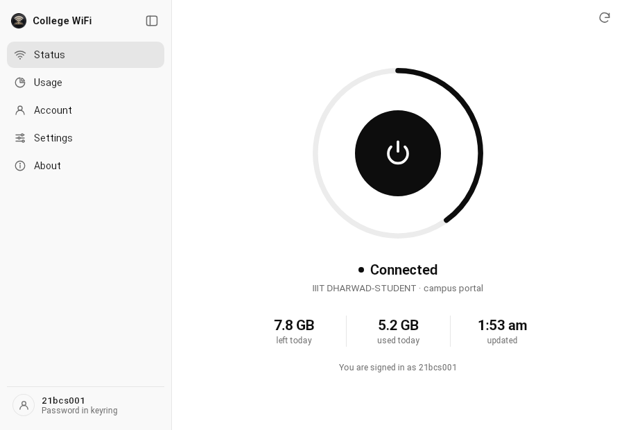
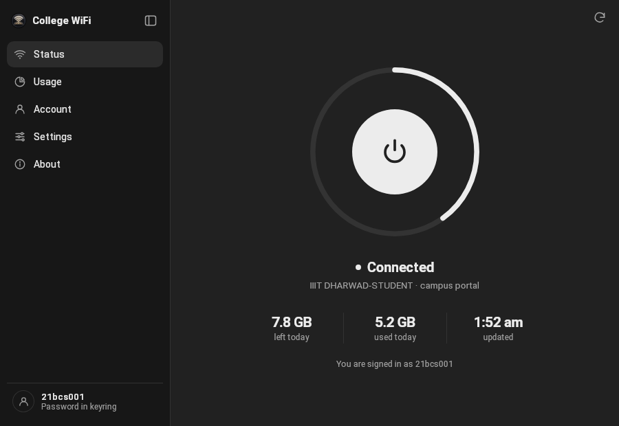
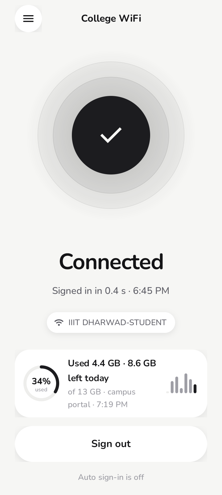
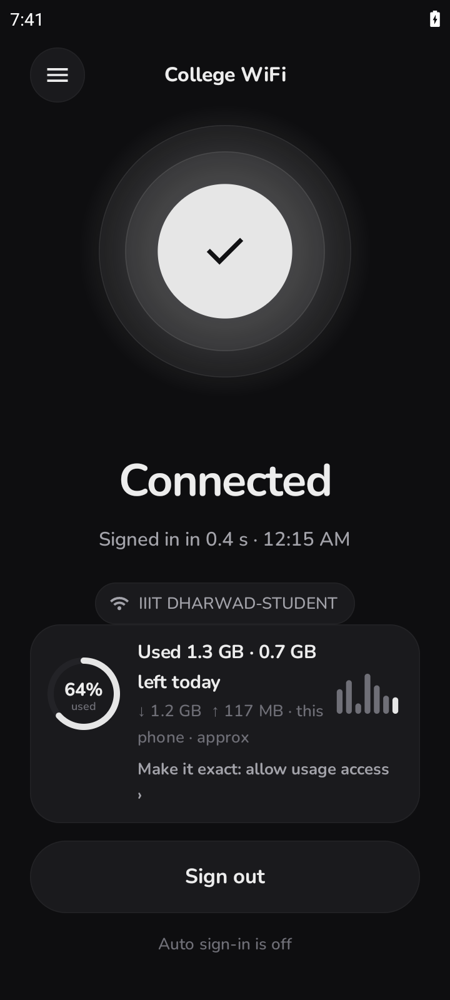

<p align="center"></p>

# College WiFi

An Android app that signs you in to your campus Wi-Fi captive portal the moment it appears, and shows how much of today's data you've used.

Built for the Sophos (Cyberoam) captive portal used at many Indian colleges. It also has drivers for FortiGate, pfSense, OPNsense, MikroTik, Aruba and generic HTML login pages.

> **Not affiliated with Sophos or with any college.** "Sophos" and "Cyberoam" are trademarks of their owners.

## Desktop app (Windows, macOS, Linux) — new

College WiFi now also runs on your laptop: the same auto sign-in, data ring and big on/off button, in a desktop window with a tray / menu-bar icon. Your password stays in the OS keychain.

<p align="center"> </p>

| OS | Download |
|---|---|
| Windows 10/11 | [Installer (.exe)](release/desktop/College_WiFi_1.0.0_x64-setup.exe) · [portable .exe](https://gofile.io/d/5OLBop49) |
| Linux | [.deb](https://gofile.io/d/Guv7rsVb) · [AppImage](https://gofile.io/d/tWcSOMcX) |
| macOS (Apple silicon + Intel) | Universal .dmg on the [Releases page](https://github.com/chinmays-tanx09/college-wifi/releases) (built by GitHub Actions) |

Details, privacy notes and build steps: [desktop/README.md](desktop/README.md).

## What it does

- **Auto sign-in.** A foreground service listens for the Wi-Fi you saved. When Android flags a captive portal, it logs in straight away. There is no polling: nothing runs while you are idle.
- **Several accounts.** If one login hits its device or data limit, the next one signs in.
- **Daily data card (new in 5.2; v5.3 fixes the campus quota showing used and limit swapped).**
  - *Used today* is measured on the phone, only while it is on the campus Wi-Fi. With **Usage access** granted, the app reads Android's own Wi-Fi counter. Without it, it estimates from whole-phone counters.
  - *Left today* comes from the campus **Sophos User Portal** ("Internet usage", the CurrentDailyCycle table) when the app can read it. Otherwise it is worked out from a daily cap you set.
  - Also: a 7-day history, optional alerts at 80% and 100%, an optional line in the status notification, and a reset at local midnight.
- Monochrome light and dark themes, and an in-app updater that only accepts APKs signed with the same key.

## Status and honesty

- The User Portal reader was built from a screenshot of the real page and is tested against a fixture rebuilt from it (`test/fixtures/`). **It has not yet been run against a live campus portal.** If it can't read the page, the app falls back to the phone's own count and your cap.
- The portal's self-signed HTTPS certificate is trusted only for the portal host, and is pinned the first time it is seen.

## Privacy

- Your portal login is encrypted on the device with the Android Keystore (AES-GCM). It is only ever sent to the portal host you confirmed for that Wi-Fi.
- No analytics, no telemetry, no servers of ours. Usage numbers stay in the app's private storage.
- The only other network call is the update check against GitHub Releases.

## Build

You need JDK 17+ and the Android SDK (build-tools 35.0.0, platform android-35). There is no Gradle: `build.sh` drives aapt, javac, R8, zipalign and apksigner directly.

```sh
export ANDROID_HOME=$HOME/Android/Sdk
# signing: a file OUTSIDE the repo that exports PARADOX_KS (keystore path), PARADOX_KS_PASS, optional PARADOX_KS_ALIAS
export PARADOX_SIGN_ENV=$HOME/.paradox/sign.env
OUT=build/College_WiFi.apk ./build.sh
./runtests.sh          # plain-JVM unit tests (no device needed)
```

The app checks its own signing certificate (`Integrity.java`) and refuses to run if the APK is re-signed. If you build with your own key, put your certificate's SHA-256 in `Integrity.EXPECTED`.

## Screenshots

| Light (campus portal quota) | Dark (your own cap) |
|---|---|
|  |  |

The screenshots come from an Android emulator with demo numbers.

## Layout

- `src/bot/paradox/wifi/`
  - `Session`, `Brain`, `Drivers`, `SophosProtocol`: the sign-in engine.
  - `Usage`, `PortalUsage`: the daily usage maths and the User Portal parser (pure Java, unit-tested).
  - `UsageTracker`, `UserPortalEngine`: the Android side of the usage feature.
  - `MainActivity`, `Ui`, `OrbView`, `UsageViews`: the UI, built in code with no AndroidX.
- `test/`: JVM tests plus a mock portal.

## License

MIT. See [LICENSE](LICENSE).


## Download

Latest: [College_WiFi_v5.3.apk](https://github.com/chinmays-tanx09/college-wifi/raw/main/release/College_WiFi_v5.3.apk) (installs over 5.2).
